
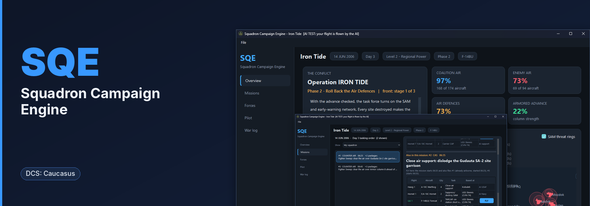

# Squadron Campaign Engine (SQE)

## Introduction

I think a lot of DCS World single-player flyers have been waiting for its dynamic campaign for years. I am one of those people. It’s a very beautiful looking game, very enjoyable flight physics and its full-fidelity modules make you really feel like you’re a pilot working on the planes’ cockpit switches.

My issue with it is after finishing a bunch of tutorials for the full fidelity aircraft and perhaps trying out the missions and stock campaigns (if the module even has them, looking at you DCS F-16C) the only thing left to do to “apply” what I learned is to… fly multiplayer? For an introverted gamer like me I can’t do that.

So what do I do? Fly Falcon BMS! It’s the gold standard for its dynamic campaign but it only has the F-16 (but lots of blocks though, but still) and just lately the F-15C. I love it.

But I want to fly the F/A-18C, the A-10C and, of course, the F-14 Tomcat! I have them on DCS World! So to get my Tomcat fix I tried some of its stock campaigns (which are GOOD but I’m not). I generate missions using DCS’ Fast Mission Generator but it only has the F-14A/B. I edit that mission using its mission editor and change it to an F-14B(U) and for some reason the waypoints are wrong. How am I gonna git gud with dropping LGBs and GBUs?

Good thing there’s DCS Briefing Room. I was able to learn to make Jester point the LANTIRN at the target and designate it. Then the explosions! Felt great! OK, time to repeat the same mission?

I tried Digital Crew Chief (DCC) and loved it too but updates come too slowly. I tried Liberation and Retribution. They’re the closest to BMS’ dynamic campaign I could get. My problem is once the “war” gets too big, so does the number of stutters per second.

So I remembered those Strike Fighters games. Simple randomly generated missions that can be flown each lasting the length of 1 cup of coffee. Following waypoints. Oh the triangle waypoint, targets are here. FPS through the roof.

That was my original inspiration for this mod. Yes, its code is written by AI. But I’m desperate. I just want “a game” inside DCS. After dozens of prompts I was able to make a… random mission generator BUT not too random. I got the background simulation to run a “war” that tracks enemy aircraft, bases and assets, along with my “squadron” and its coalition. Click FLY and I get waypoints on a kneeboard along with radio channels tuned the way I like it, similar to BMS.

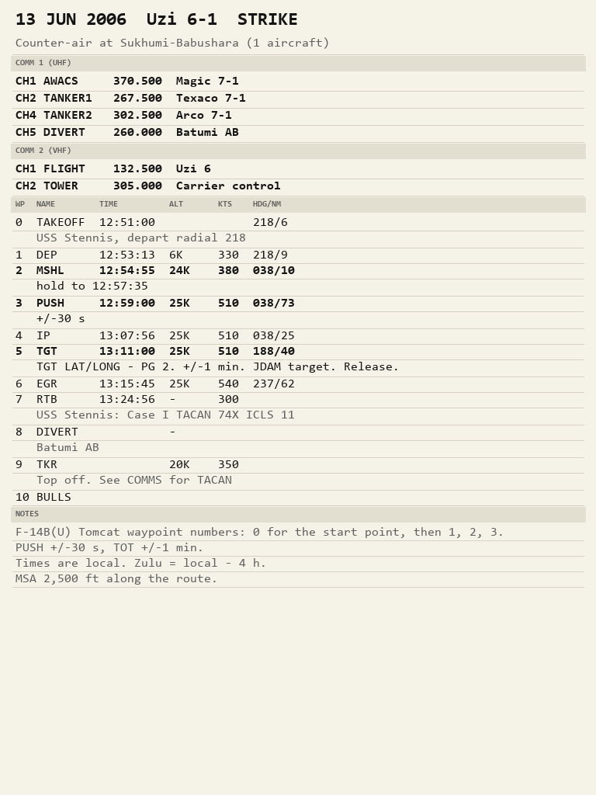 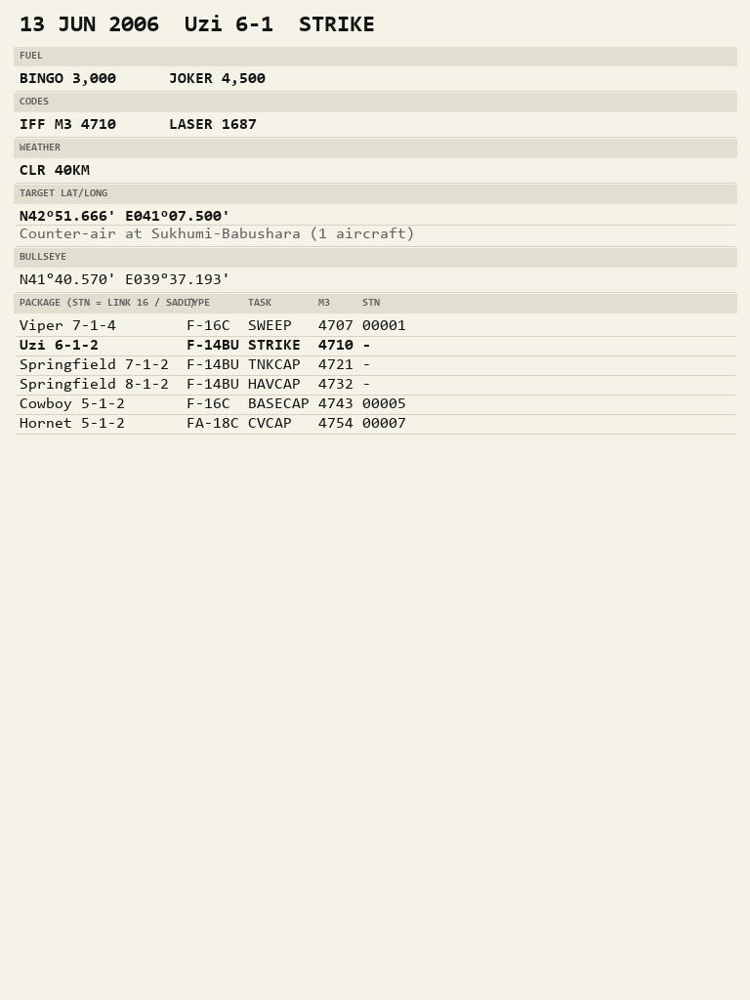 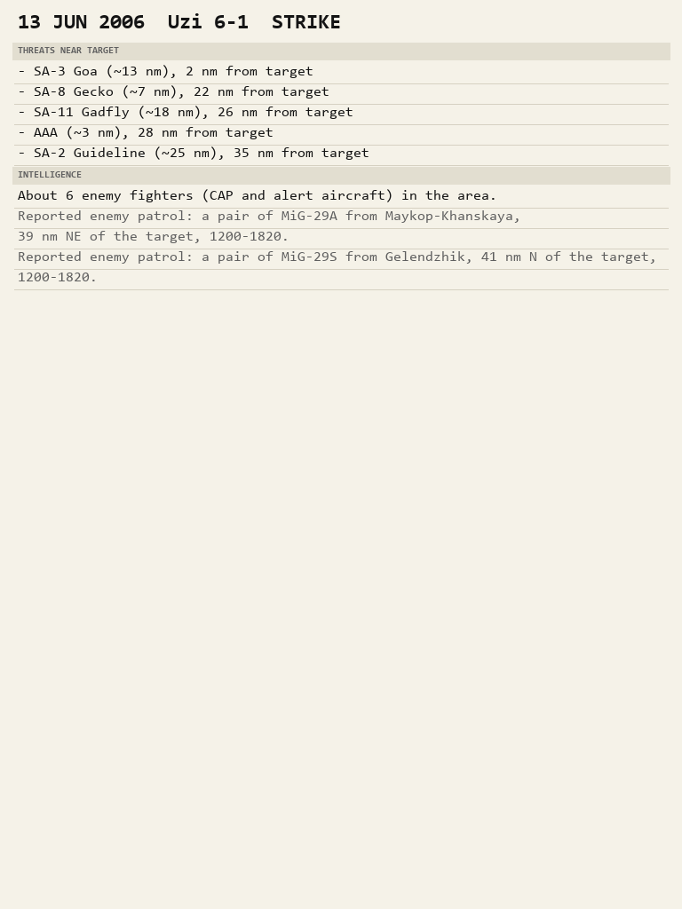

At first OMG IT’S WORKING! Flies well with VR too! And the enemies are always where they should be! And I’m on a package of flights with a mission.

After a few more design changes I was able to end up with “package merging” where packages with targets geographically close to each other are also on the same mission. Even the TOTs for the targets are still there so not all packages fly at the same time!

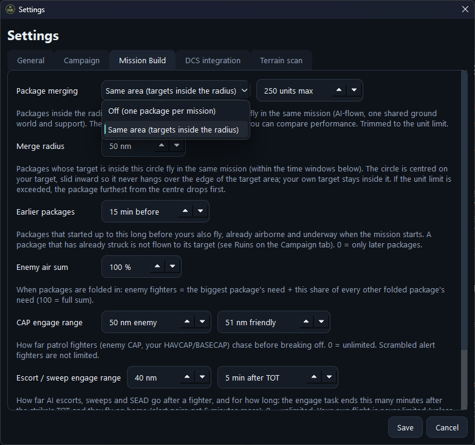

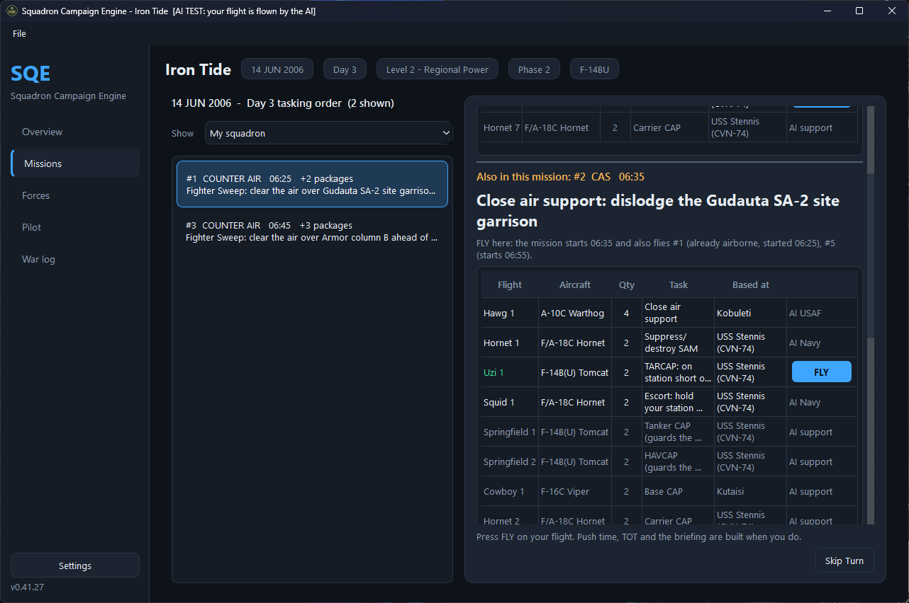

So, yeah. I just wanted to share this with fellow DCS World flyers. I spent sleepless nights tuning the mission planner like playing an RTS game (was really fun seeing things work) to kinda eliminate banzai actions and herd hundreds of units to at least not die and have a somewhat positive debrief afterwards (it’s really hard to make the commanders happy).

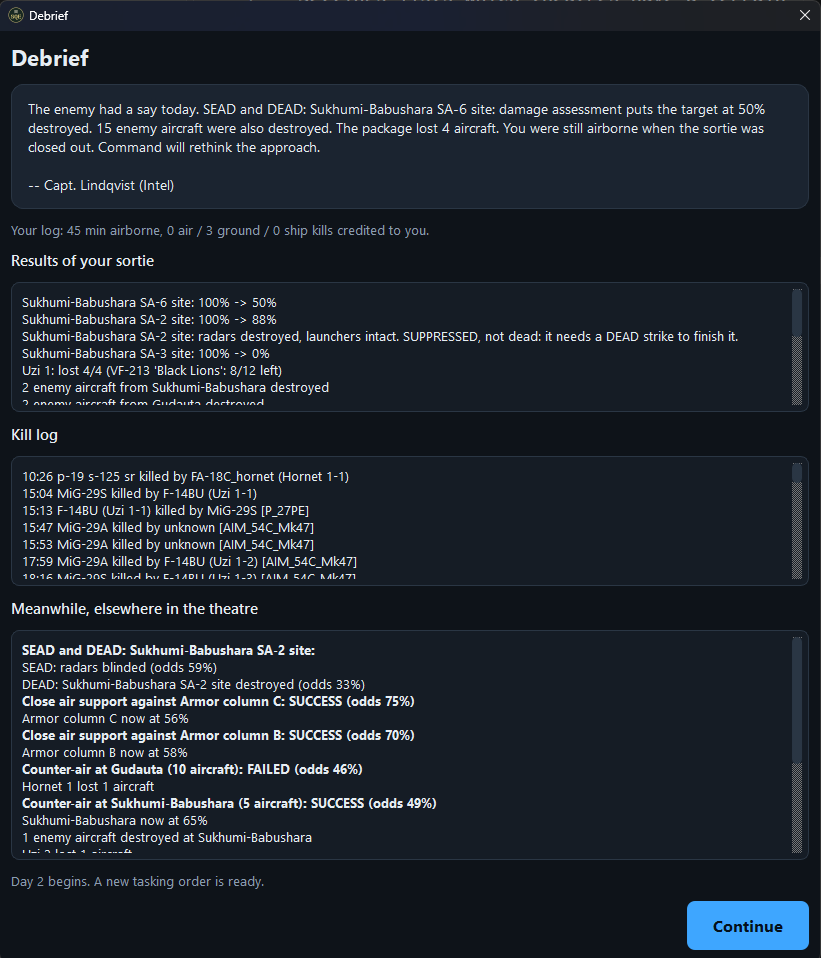

This lets me play DCS the way I like it. I hope others get to enjoy it too. Download it, play it, fork it, etc. Have fun!

## Screenshots

| | |
|---|---|
| 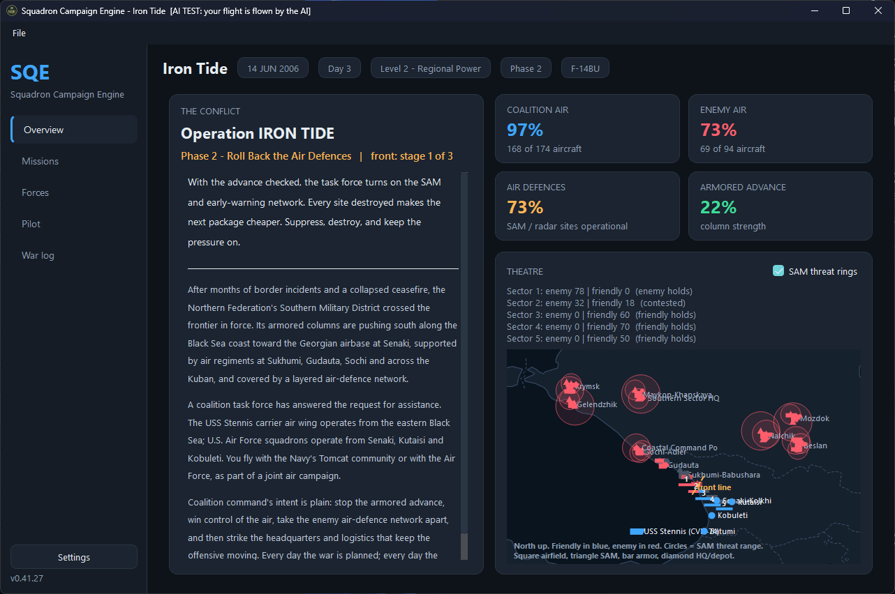 | 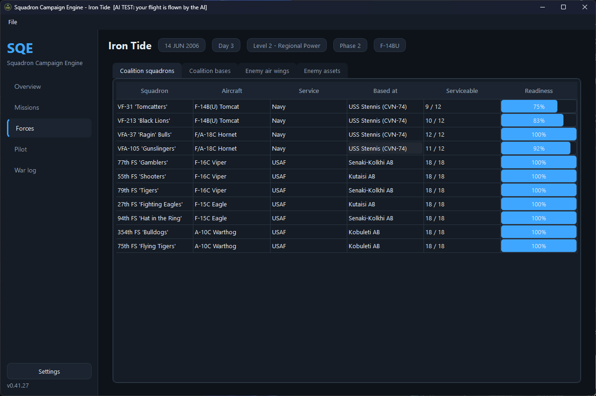 |
| 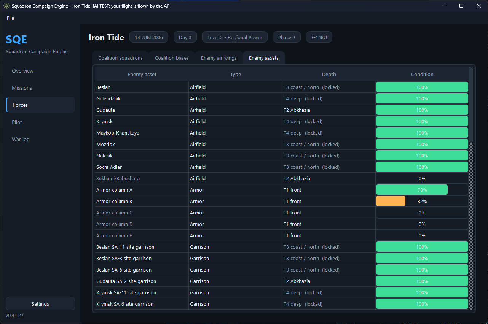 | 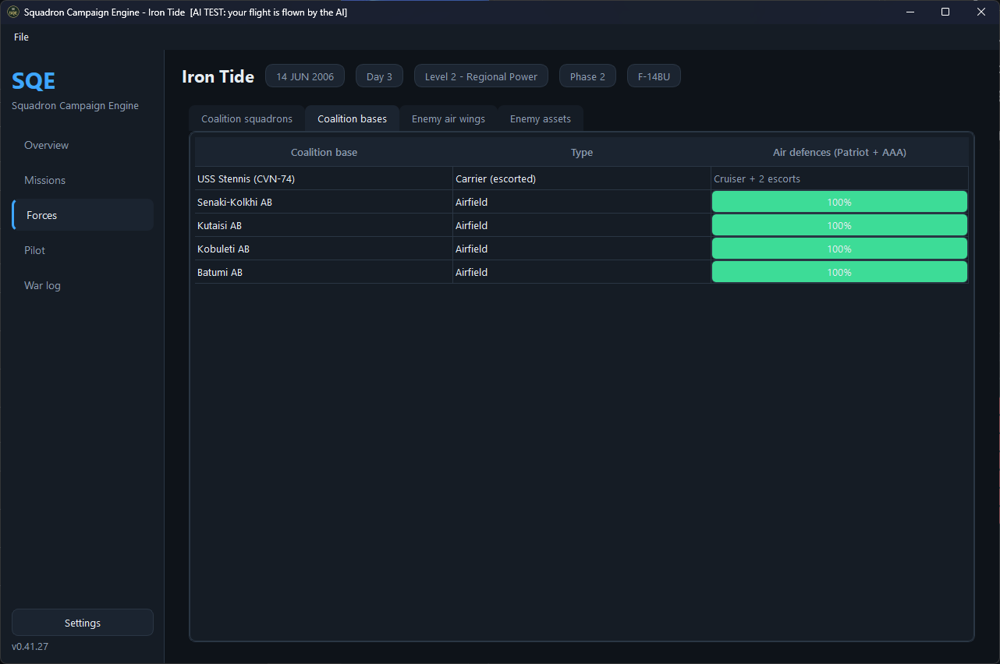 |
| 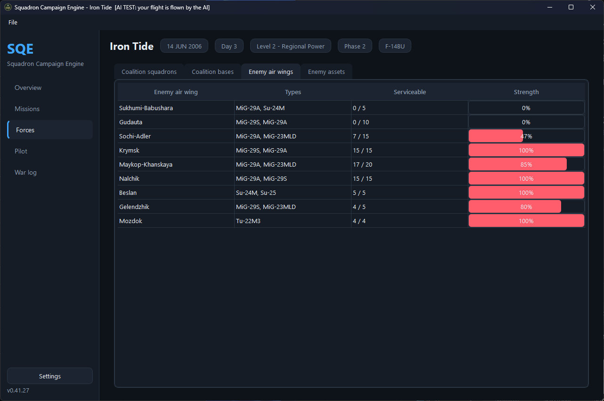 | 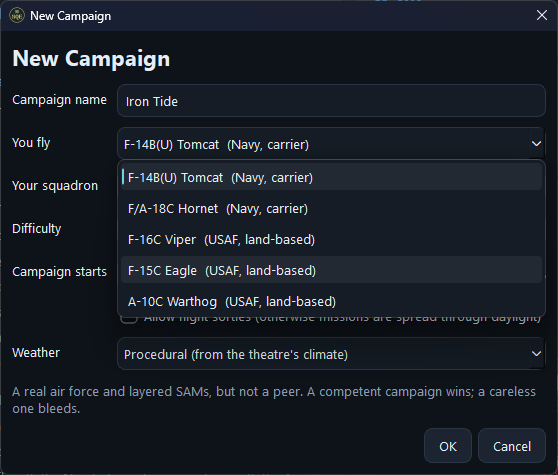 |
| 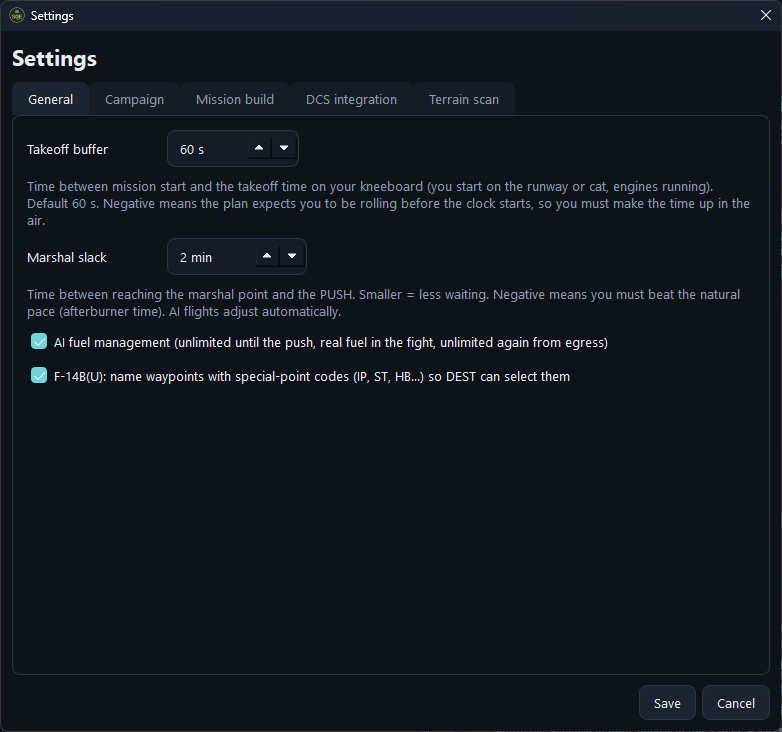 | 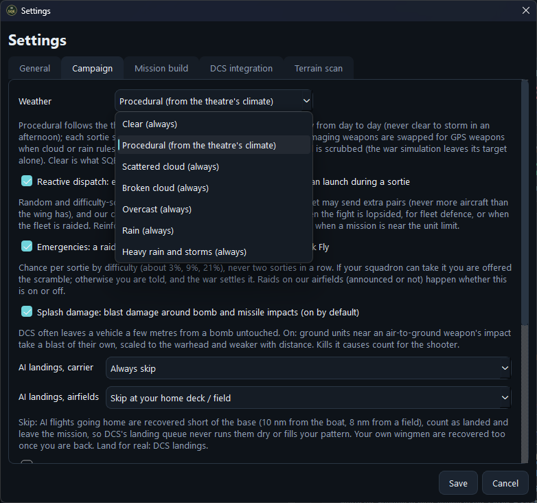 |
|  | 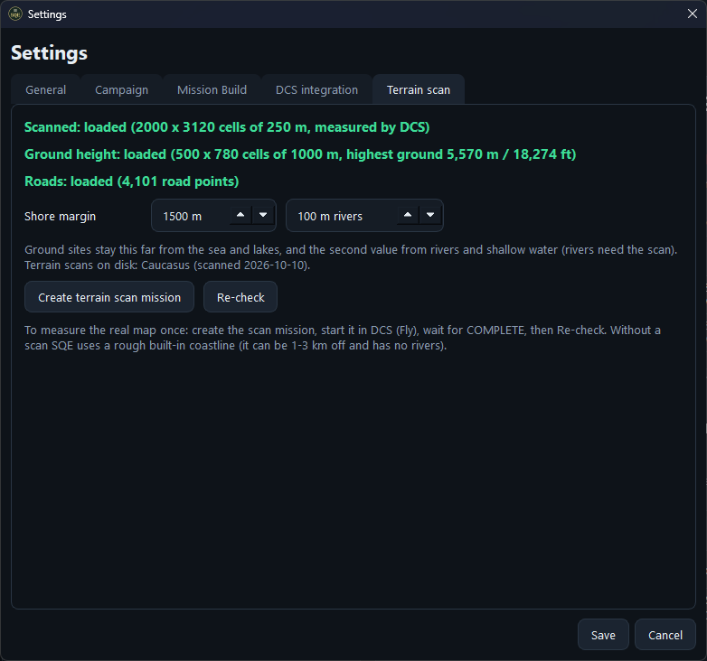 |

## Get started

<a href="https://github.com/MarkuzJuniuz/SQE/releases/latest"><b>⬇ Download the latest release</b></a>

1. Download **`SQE_vX.Y.Z.zip`** from the [latest release](https://github.com/MarkuzJuniuz/SQE/releases/latest).
2. Extract the whole `SQE` folder anywhere (not inside DCS's own folders) and run **`SQE.exe`**. Keep the folder together; the .exe needs the files beside it.
3. Windows may show **"Windows protected your PC"** because SQE isn't code-signed. Click **More info → Run anyway**.
4. On first run, set the two folders in Settings (your DCS install and `Saved Games\DCS`) and answer the scripting-access question (see Legal below).

Needs Windows and DCS World with the Caucasus map. To update, extract the new zip over the old folder; campaigns are kept in `Saved Games\DCS\SQE`.

### Running from source

Start here: **docs/GUIDE.md**   |   Sample briefing: docs/SAMPLE_BRIEFING.txt

    py -m venv .venv && .venv\Scripts\Activate.ps1
    pip install -r requirements.txt
    python tools/smoke_test.py      # headless self-test
    python -m sqe                   # the app

## Legal

* SQE is released under the **MIT licence** (`LICENSE`, copyright MarkuzJuniuz). It is **free of charge and non-commercial**, as DCS World's EULA requires of anything built on it. Debrief results need DCS's `MissionScripting.lua` opened up; SQE asks you on first run and does this **only if you agree** (default off, change it in Settings).
* It is **not made or supported by Eagle Dynamics SA**. It contains no DCS files; see `THIRD_PARTY_NOTICES.md` for the libraries it uses and their licences.
* **What the MissionScripting.lua option does**: DCS blocks `io` and `lfs` in mission scripts, which SQE needs to read your sortie results. With the setting on, SQE comments out
  those sanitizing lines in your own `MissionScripting.lua` when it starts (a backup is saved beside it) and restores the file when it closes. It changes nothing else. DCS updates and repairs can
  overwrite the file, which is why SQE re-applies the change at every start. If you play multiplayer, close SQE first so the file is unmodified.
* Use at your own risk; there is no warranty.

## Inspiration

Many of SQE's ideas are inspired by community campaign tools, especially DCS Liberation and DCS Retribution (a front line that moves as targets fall, packages with escorts and SEAD, the MissionScripting approach for results, AI fuel management). The procedural feel comes from Falcon BMS: the marshal, push and TOT timeline, other flights running to schedule whether you're there or not, and the radio chatter that lets you follow the package. The sense of flying your sortie while the war goes on around you comes from the Strike Fighters series. SQE contains no code from any of them and is not affiliated with them.
